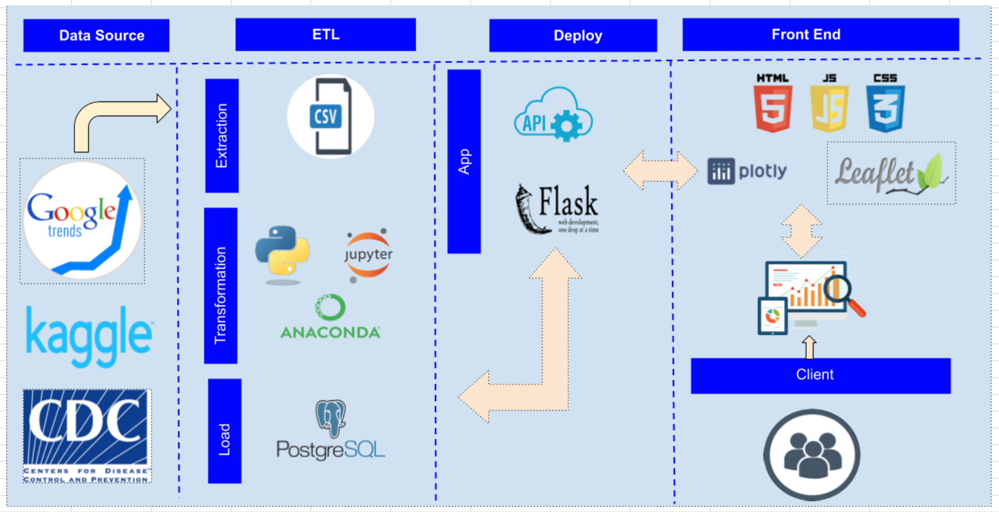

## Google Health Search Trends by US Metropolitan Area, 2004 – 2017

## Project Goal
Google Trends data allows us to see what people are searching for at a very local level. The goal of this project is to track, and visualize the top searches for common health issues in the United States, from Cancer to Diabetes, and compare them with the actual location of occurrences for those same health conditions to understand how search data reflects life for millions of Americans.

## Research Question
How have the most searched diseases changed over the years in the US?

## Data sources
* Kaggle: Health searches by US Metropolitan Area, 2004-2017
   - https://www.kaggle.com/GoogleNewsLab/health-searches-us-county
   
* CDC Data: 10 leading causes of death per 100,000 population from 2004-2017 
   - https://www.cdc.gov/nchs/fastats/deaths.htm
   
## Data Architectural Diagram 

## ETL

### EXTRACT 

Data sourced from Google Trend, specifically Google Health Search from 2004 - 2017.

### Transform

Data cleaned and transformed by using Python Jupyter Notebook. [`Health_Analysis.ipynb`](https://github.com/ermiasgelaye/Google-Health-Search-Project/blob/master/Data/Data_Cleaning/Health_Analysis.ipynb)

### LOAD 

- This project used Python Jupyter Notebook to load transformed data in to PostgreSQL database. [`loadData.ipynb`](https://github.com/ermiasgelaye/Google-Health-Search-Project/blob/master/Data/database/load_in_to_db/loadData.ipynb)

- Python Flask–powered RESTful API were used to deploy the data into the web, and API end point links created.

## Deployment
**Live site:** [ermiasgelaye.github.io/Google-Health-Search-Project](https://ermiasgelaye.github.io/Google-Health-Search-Project/)

The dashboard is a fully static site hosted free on **GitHub Pages**, so it never sleeps or fails because of a free-tier server or database:

- **Data endpoints** are pre-computed JSON files in `static/data/` (same format the Flask API returned). After editing a CSV in `Data/database/load_in_to_db/`, rebuild them with `python3 tools/build_static.py`.
- **The chat assistant** runs in the browser (`static/js/chat-engine.js`) and calculates every number it states from the dataset.
- **Optional:** `python3 app.py` serves the site locally (and keeps the old URLs such as `/searchbyyear` working) with no database.

To publish: GitHub → *Settings → Pages* → Deploy from branch `master`, folder `/ (root)`.

## Data Analysis and Visualization

The following visualization made:

### Health Search Volume by State and Region (Choropleth map)

### Interactive Charts With Dropdown Selection "City"

###  Health Search Volume by Year (Single Line Chart)

###  Health Search Volume by Year and Condition (Multiple Line Chart)

###  Health Search volume by State.

###  Correlation Between Health Conditions

### Boxplot of Health Google Search 2004-2017

### Radar Plot on All Time Total Volume of Health Searches

### Radar Plot on the Sum Total Volume of 10 Leading Causes of Death Per 100,000 Population from 2004-2017

## Team members (Team Eagle)
* Adedamola Atekoja (‘Damola)
* Amanda Qianyue Ma
* Amos Johnson
* Ermias Gaga
* Maria Lorena
